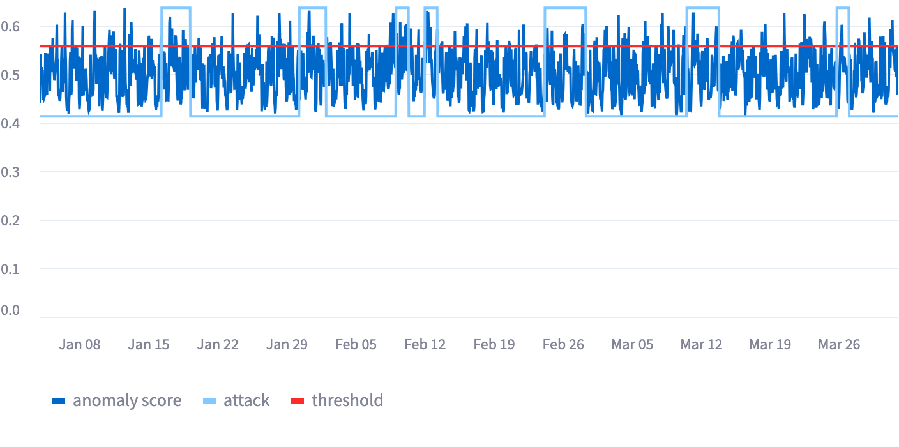

# batadal-anomaly-detection

Attack detection on BATADAL water distribution SCADA data. The project trains an isolation forest on normal operation only, tunes the alarm threshold on labeled attacks, and scores the detector with the official BATADAL metric S.



## Problem

Attackers in the BATADAL dataset manipulate pumps, valves, and tank level signals. Several attackers conceal the manipulation by replaying normal sensor readings to SCADA. Operators need a detector that flags attack hours early and keeps false alarms within a fixed budget.

## Data

The BATADAL organizers publish all data at [batadal.net](https://www.batadal.net/data.html) under the [CC BY 4.0](http://creativecommons.org/licenses/by/4.0/) license. The project renames each file for brevity. The table maps each original file to the local path that the code reads.

| Source | Original file | Local path | Hours | Role |
|---|---|---|---|---|
| Training Dataset 1 | `BATADAL_dataset03.csv` | `data/train_normal.csv` | 8,761 | Model fit on normal operation |
| Training Dataset 2 | `BATADAL_dataset04.csv` | `data/train_attacks.csv` | 4,177 | Threshold tuning; 7 attacks, 219 of 492 attack hours labeled |
| Test Dataset | `BATADAL_test_dataset.zip` | `data/test.csv` | 2,089 | Single final evaluation; 7 attacks, labels withheld |
| [Results page](https://www.batadal.net/results.html) | `Brentan_et_al.csv` | `data/reports/brentan.csv` | | Scorer verification |

Download the files from the repo root:

```bash
mkdir -p data/reports
curl -o data/train_normal.csv https://www.batadal.net/data/BATADAL_dataset03.csv
curl -o data/train_attacks.csv https://www.batadal.net/data/BATADAL_dataset04.csv
curl -o data/reports/brentan.csv https://www.batadal.net/data/Brentan_et_al.csv
curl -o BATADAL_test_dataset.zip https://www.batadal.net/data/BATADAL_test_dataset.zip
unzip -l BATADAL_test_dataset.zip
```

Extract the test CSV from `BATADAL_test_dataset.zip` and save the CSV as `data/test.csv`.

The test file does not include labels. `labels/test_attacks.csv` transcribes the [published test attack list](https://www.batadal.net/images/Attacks_TestDataset.png), and `docs/test_attacks.png` reproduces the list.

> Taormina, R., et al. (2018). The Battle of the Attack Detection Algorithms: Disclosing Cyber Attacks on Water Distribution Networks. *Journal of Water Resources Planning and Management*, 144(8). https://doi.org/10.1061/(ASCE)WR.1943-5452.0000969

## Run

pandas 3.0.6 requires Python 3.11 or later. Run every command from the repo root. `app.py` reads relative paths such as `data/train_normal.csv`, and `python -m pytest` places the repo root on the import path so `from src.evaluate import batadal_score` resolves.

```bash
python3 -m venv .venv
source .venv/bin/activate
pip install -r requirements.txt
python -m pytest
streamlit run app.py
```

## Method

- `src/model.py::fit` trains an `IsolationForest` with `random_state=42` on the 43 sensor columns of `data/train_normal.csv`. The pipeline does not scale features because the isolation forest splits on one feature at a time.
- `src/model.py::score` returns `-model.score_samples(X)`, so a higher score marks a more anomalous hour.
- `src/model.py::pick_threshold` draws 100 candidate thresholds between the 90th and the 99.9th percentile of normal operation scores. Each candidate therefore flags at most 10% of normal hours. `pick_threshold` selects the candidate with the highest S on `data/train_attacks.csv`.
- `eda.ipynb` scores `data/test.csv` once, after the author locked every setting.

`src/evaluate.py::batadal_score` implements the official metric: S = 0.5 × S_TTD + 0.5 × S_CM. S_TTD rewards early detection within each attack window. S_CM averages the true positive rate (TPR) and the true negative rate (TNR).

## Results

| Detector | Data | Attacks detected | S | TPR | TNR |
|---|---|---|---|---|---|
| Flag every hour | Tuning | 7 / 7 | 0.750 | 1.00 | 0.00 |
| v0.1 isolation forest | Tuning | | 0.740 | 0.32 | 0.88 |
| Flag every hour | Test | 7 / 7 | 0.750 | 1.00 | 0.00 |
| **v0.1 isolation forest** | **Test** | **7 / 7** | **0.702** | **0.16** | **0.90** |
| Brentan et al., published | Test | 6 / 7 | 0.894 | | |
| Housh and Ohar, published winner | Test | 7 / 7 | 0.970 | | |

The test false alarm rate equals 10.3%. `batadal_score` reproduces the published Brentan et al. score of 0.894 from `data/reports/brentan.csv`. The match verifies the scorer against the [official results](https://www.batadal.net/results.html).

`src/evaluate.py::detection_delays` measures each delay as the hours between the attack start and the first flag inside the attack window.

| Attack | Targeted components | Duration in hours | Hours to first flag |
|---|---|---|---|
| 8 | T3, PU4, PU5 | 70 | 19 |
| 9 | T2, V2 | 65 | 1 |
| 10 | PU3 | 31 | 1 |
| 11 | PU3 | 31 | 0 |
| 12 | T2, V2 | 100 | 6 |
| 13 | T7, PU10, PU11 | 80 | 15 |
| 14 | T4 | 30 | 9 |

## Findings

- S weights early detection and classification equally. A detector that flags every hour therefore scores 0.750. v0.1 scores below the reference on both the tuning file and the test file.
- Background alarms explain most fast detections. Seven columns stay constant across `data/train_normal.csv`: `S_PU1`, `F_PU3`, `S_PU3`, `F_PU5`, `S_PU5`, `F_PU9`, and `S_PU9`. The isolation forest cannot split on a constant column, so the model cannot detect attacks 10 and 11 on pump PU3. The detector still flags both attacks within one hour. A 10% alarm rate produces a random flag within about 9 hours of any attack start, so chance accounts for both detections. The author identified the PU3 blind spot after reading the published test attack list.
- The model scores each hour independently. Replay concealment makes each attacked hour resemble normal operation, so a single hour view misses concealed attacks.
- `src/features.py::add_time_features` adds hourly change, 24 hour rolling deviation, and hour of day. The time context features lowered tuning S from 0.740 to 0.732 at the same budget. The project did not adopt the features for v0.1, and the 0.008 gap may fall within seed variation.

## Limitations

- Simulated data: the datasets come from a hydraulic simulation and do not include network protocol traffic.
- Partial tuning labels: `data/train_attacks.csv` labels 219 of 492 attack hours and does not label any hour of attacks 2 and 7. Tuning counts the 273 unlabeled attack hours as false alarms.
- In sample budget: `pick_threshold` measures the 10% budget on the same rows that trained the model, not on a normal split held out from training.
- Single seed: every result uses `random_state=42`.

## Project layout

```
app.py            Streamlit dashboard; runs the full pipeline
src/data.py       CSV loading, feature selection, label mapping
src/model.py      isolation forest fit, scoring, threshold search
src/evaluate.py   attack windows, delays, TPR and TNR, score S, report parsing
src/features.py   experimental time context features; app.py does not use the module
tests/            metric and scorer tests
eda.ipynb         data checks, tuning, and the single test run
labels/           transcribed test attack list
docs/             dashboard screenshot and published test attack list
```

## Next

- A rule that flags any change in a column constant during training
- A normal split held out from training for the false alarm budget
- Feature family comparisons across several seeds
- An autoencoder comparison at the same budget
- A storage layer on MySQL and AWS RDS

## License

The MIT License in `LICENSE` covers the code. CC BY 4.0 covers the BATADAL data.